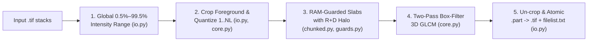

# collagen_3D_multimetric

# combining multiple software outputs for collagen analysis
-workflow for aggregating collagen data from several sources (CurveAlign, TWOMBLI, texture) and parsing

-parse_into_dataframe_NOslices.py aggregrates data by stack

-parse_into_dataframe_YESslices.py aggregrates data per image slice (also has the 3D glcm functions)

-fanalyze_dataframe.ipynb runs test plots on exported full .csv dataframe

-RF_regression.py trains random forest regressor on .csv dataframe to separate given condition and ranks importance of features (assembled from the different software outputs)


-spiral files are ground truth data that can be used for glcm comparisons and testing


# 3D GLCM Texture Analysis

MATLAB implementation of voxelwise 3D Gray-Level Co-occurrence Matrix (GLCM) texture feature extraction from volumetric fluorescence microscopy images.

Derived from:
- https://github.com/Pedram-Parnianpour/VGLCM-TOP-3D-Texture-Analysis
- https://journals.plos.org/plosone/article?id=10.1371/journal.pone.0117759
- claude (sonnet 4.6) used to help modify code.

Requires:
- **Image Processing Toolbox** 
- **Parallel Computing Toolbox** 

### Input Data Format
- 3D image stacks saved as multi-page `.tif` files
- The mask is derived directly from the image — any voxel with intensity `> 0` is treated as inside the mask. Pre-apply your mask to the image before running.

| Distance | `OPT.D` | Radius for directional offset vectors. Controls how far apart co-occurring voxel pairs can be. |
| Neighborhood size | `OPT.NeighborSize` | Radius for local neighborhood averaging around each voxel. |
| Quantization level | `OPT.quantLevel` | Number of gray level bins. Typical values: `8`, `16`, `32` |
| Features | `OPT.glcm_properties` | Cell array of feature name strings to compute. |
| Input folder | `folder` | Full path to folder containing input `.tif` files |
| Output folder | `outpath` | Full path to folder where output `.tif` files and cached `.mat` files will be saved |

---
## Supported Texture Features

Pass any combination of these strings in `OPT.glcm_properties`:

| String | Feature |
|---|---|
| `autoc` | Autocorrelation |
| `contr` | Contrast |
| `corrm` | Correlation (MATLAB definition) |
| `corrp` | Correlation (paper definition) |
| `cprom` | Cluster Prominence |
| `cshad` | Cluster Shade |
| `dissi` | Dissimilarity |
| `energ` | Energy |
| `entro` | Entropy |
| `homom` | Homogeneity (MATLAB definition) |
| `homop` | Homogeneity (paper definition) |
| `maxpr` | Maximum Probability |
| `sosvh` | Sum of Squares Variance |
| `savgh` | Sum Average |
| `svarh` | Sum Variance (Haralick 1973 formula using `senth`) |
| `svarc` | Sum Variance (corrected formula using `savgh`) |
| `senth` | Sum Entropy |
| `dvarh` | Difference Variance |
| `denth` | Difference Entropy |
| `inf1h` | Information Measure of Correlation 1 |
| `inf2h` | Information Measure of Correlation 2 |
| `indnc` | Inverse Difference Normalized |
| `idmnc` | Inverse Difference Moment Normalized |


## Memory Considerations

Memory usage scales with: numMaskedVoxels × numOffsets × (numNeighbors + 1)
Start with `OPT.quantLevel = 8` for testing, increase to `16` or `32` for final analysis
`parfor` parallelises across files — performance scales with the number of input files and available CPU cores

---

## Functions (MATLAB)
| `ComputeOffsets(dis)` | Generates all 3D integer offset vectors within a sphere of radius `dis` |
| `AllOffsetsAllNeighbors(I, D, NeighborSizeRad, mask)` | Precomputes start/end voxel index mappings for all offset and neighbor combinations |
| `CreateGLCM_Local(I, NL, GL, D, NeighborSizeRad, mask)` | Builds a normalized local GLCM for every masked voxel |
| `computeGLCMLocalFeat(glcm, mask, GLCM_feat)` | Iterates over masked voxels and extracts texture features from each local GLCM |
| `computeFeature(glcm, GLCM_feat_all)` | Computes all requested features from a single voxel's 2D GLCM |

---

# Python `glcm3d` Package (CLI, Python API & Tkinter GUI)

A pure-Python, cross-platform port of `src/calculate_glcm3D/glcm3D_attempt.m` lives in `src/glcm3d/` (packaged as `glcm3D` in `pyproject.toml`).

### Installation
```bash
uv sync
# or with pip:
pip install -e .
```

### Processing Steps (`src/glcm3d/`)



1. **Global Intensity Range (`src/glcm3d/io.py`)**: Scans foreground (`> 0`) voxels across all input `.tif` files (16-bit `np.bincount` histogram for `uint8`/`uint16`, `np.percentile` fallback for floating-point or >16-bit stacks) to compute global 0.5th–99.5th percentiles so quantization is consistent across an entire dataset.
2. **Foreground Crop & Quantization (`src/glcm3d/io.py`, `src/glcm3d/core.py`)**: Builds `mask = vol > 0`, crops each volume to the tight 3D foreground bounding box, and linearly quantizes foreground intensities to `1..NL` (`uint8` for `NL <= 255`, `uint16` otherwise).
3. **Memory-Safe Slab Chunking (`src/glcm3d/chunked.py`, `src/glcm3d/guards.py`)**: Checks live available RAM (`/proc/meminfo` + cgroup v2 on Linux; `GlobalMemoryStatusEx` on Windows) and free disk space (`shutil.disk_usage`), reserves memory for the output tensor, and splits the volume along its longest axis into slabs with a `R + D` voxel halo on each side so slab boundaries match whole-volume processing. Empty slabs are skipped.
4. **Two-Pass Box-Filter 3D GLCM (`src/glcm3d/core.py`)**: Avoids allocating a massive 5D `(Y, X, Z, NL, NL)` GLCM array by shifting the volume over `compute_offsets(D)` (18 symmetric offsets for `D=1`: 6 face + 12 edge neighbors) and summing co-occurrence counts over `(2R+1)³` cubic windows via three separable 1D `cumsum` passes (`box_filter_3d`) in `float64`:
   - **Pass 1 (Marginals):** Accumulates exact `float32` counts for `p_x`, `p_y`, `p_xplusy`, `p_xminusy`, and `total_safe`, converts to `float64` probabilities, and computes means/stds, entropies, and the 6 marginal-only features (`savgh`, `senth`, `svarh`, `svarc`, `denth`, `dvarh`). Returns early if only marginal features are requested.
   - **Pass 2 (Joint Features):** Recomputes `Pij` on the fly per `(gi, gj)` pair and accumulates only the requested joint features (`autoc`, `contr`, `dissi`, `energ`, `entro`, `homom`, `homop`, `sosvh`, `indnc`, `idmnc`, `maxpr`, `corrm`, `cprom`, `cshad`, `inf1h`, `inf2h`), then replaces non-finite values with `0` and zeros voxels outside `mask`.
   - **Fixes vs. legacy MATLAB script:** `sosvh` uses the gray-level mean `u_y` (`sum(Pij * (gj - u_y)^2)` instead of `1/NL^2`), and all entropy terms use exact `0 * log(0) = 0` without `+ eps` bias (eliminating negative-`eps` artifacts and `inf1h` instability on constant windows).
5. **Atomic TIFF Output & Resume (`src/glcm3d/io.py`, `src/glcm3d/pipeline.py`)**: Un-crops each feature back into original volume dimensions, writes lossless Deflate-compressed `float32` multi-page TIFFs to `*.part`, atomically renames (`os.replace`) on completion, and logs finished filenames to `filelist.txt` so interrupted runs resume cleanly. Any stale `*.part` files from prior crashes are deleted on startup.

#### Package Module Map
| Module | Responsibility |
|---|---|
| `src/glcm3d/config.py` | `ALL_FEATURES` (23), `MARGINAL_ONLY_FEATURES`, `GLCMConfig` dataclass (`from_json`), and `ProgressCallback` type |
| `src/glcm3d/core.py` | `compute_offsets`, `quantize_volume`, `box_filter_3d`, `shift_volume`, `compute_windowed_glcm_features`, `finalize_texture` |
| `src/glcm3d/chunked.py` | `compute_chunked` slabbed driver with `R + D` halo and per-slab progress reporting |
| `src/glcm3d/guards.py` | Cross-platform RAM & disk space checks (`get_available_mem_bytes`, `get_free_disk_bytes`, `ensure_memory`, `ensure_disk`) |
| `src/glcm3d/io.py` | Multi-page TIFF I/O (`(Z, Y, X) <-> (Y, X, Z)`), global percentiles, foreground cropping, atomic `.part` writes, `filelist.txt` |
| `src/glcm3d/pipeline.py` | `run_pipeline` (directory batch + resume) and `run_single_file` (single `.tif` + progress callbacks) |
| `src/glcm3d/cli.py` & `__main__.py` | `glcm3d` / `python -m glcm3d` headless CLI |
| `src/glcm3d/gui.py` | `glcm3d-gui` / `python -m glcm3d.gui` Tkinter single-file picker with background worker thread and live progress bar |

### CLI Usage (Headless / Linux Server / Windows)
```bash
# Run on a folder of multi-page .tif stacks
uv run python -m glcm3d \
  --input /path/to/tif_folder \
  --output /path/to/output_folder \
  --d 1 \
  --radii 1 3 \
  --quant-level 8 \
  --min-free-disk-gb 20
```
- You can also invoke the installed entry point directly: `uv run glcm3d ...` (or `.venv/bin/glcm3d` on Linux, `.venv\Scripts\glcm3d.exe` on Windows).
- **Useful flags:**
  - `--features contr entro energ sosvh` — compute a subset of the 23 features
  - `--num-z 71` — slice a fixed number of Z pages per stack
  - `--config config.json` — load defaults from `config.json`
  - `--list-file /path/to/filelist.txt` — custom resume list path (default: `<output>/../filelist.txt`)
  - `--no-compress` — disable lossless Deflate compression
  - `--interactive` — pause for confirmation after printing the global intensity percentile range
- **CLI status output:** Prints live status lines to `stdout` (completed count, intensity range, available RAM/disk, slab plan, per-file/radius timing, and skipped files). For long SSH runs, wrap with `tmux` or `nohup ... > glcm3d.log 2>&1 &`.

### Python API (Batch & Single-File)
```python
from glcm3d import GLCMConfig, run_pipeline, run_single_file

cfg = GLCMConfig(d=1, neighbor_sizes=(1, 3), quant_level=8, min_free_disk_gb=5.0)

# Single .tif file (does not touch filelist.txt; supports progress_callback)
run_single_file("path/to/stack.tif", "path/to/output", config=cfg)

# Directory batch run (with resume tracking via filelist.txt)
run_pipeline("path/to/tif_folder", "path/to/output", config=cfg)
```

### Tkinter GUI (Single-File Picker & Progress Bar)
Requires a desktop/X11 display (on Ubuntu: `sudo apt install python3-tk`):
```bash
uv run python -m glcm3d.gui
# or via GUI entry point:
uv run glcm3d-gui
```

### Running Tests
```bash
uv run python -m unittest discover -s tests -v
```
- `tests/test_glcm3d.py` — 12 tests verifying all 23 features against an independent brute-force 3D GLCM reference, slab chunking equivalence, edge cases, pipeline resume, and ground-truth spiral smoke test.
- `tests/test_cli_and_gui.py` — 16 tests covering packaging, `python -m glcm3d`, `run_single_file`, progress callbacks, and Tkinter GUI lifecycle/threading safety.


# Collagen 3D Multimetric Pipeline

**Repos:** [hwilson23/collagen_3D_multimetric-main](https://github.com/hwilson23/collagen_3D_multimetric-main) · [hwilson23/image_texture_analysis](https://github.com/hwilson23/image_texture_analysis)

---

## Acquisition

3-channel OME-TIFF time-series acquired via MDA (Multi-Dimensional Acquisition):

| Channel | Excitation | Label |
|---|---|---|
| NucBlue | 800 nm | Cell nuclei |
| Fluorescent collagen | 800 nm | No-SHG collagen marker |
| SHG collagen | 890 nm | Forward/backward SHG |

- **740 nm** z-stacks also acquired **before and after** the main time-series as a cell position reference.
- Preset name: `3ch-back` — 3-channel collection with backward SHG geometry. *(details TBD)*

---

## Step 1 — OME-TIFF Preprocessing

**Script:** `splitstack_toindiv_image.py`

- Split OME-TIFF by channel and Z/T dimensions
- Separate time-series into individual TIFFs: `T1, T2, T3, ...`
- Apply background subtraction; encode background value in filename
- Add `tX_sX` suffix for time index and z-slice index

**Reference:** `serp.mm-timestack.m` (MATLAB serpentine time-stack utility)

---

## Step 2 — ROI Masking

**Masks defined manually in ImageJ** (`.ijm` macro) based on the 740 nm z-stack at the final time point.

Three concentric area regions per field:

| Label | Definition |
|---|---|
| **A0** | Cell body (direct cell mask) |
| **A1** | Peri-cellular zone (A0 + dilation) |
| **A2** | Extracellular zone (A0 + further dilation) |

**Script:** `apply_aramask.py` — applies A0/A1/A2 masks to preprocessed images.

---

## Step 3 — 3D GLCM Texture Analysis

**Script:** MATLAB (`glcm_3d_attempt.m`), derived from [VGLCM-TOP](https://github.com/Pedram-Parnianpour/VGLCM-TOP-3D-Texture-Analysis)

- Run on server (memory-intensive)
- Stack split into **4 quadrants** to fit in memory, then recombined with `combine_quadimag.py`
- Outputs: `.mat` cache + per-feature `.tif` stacks
- TOP variant: three orthogonal planes; orthogonal-plane slices removed from output
- Kernel parameters (distance, neighborhood size, quantization level) encoded in output filename by Helen
- Applied independently to A0, A1, A2 masked images

---

## Step 4 — CurveAlign / CT-FIRE Fiber Analysis

**Script:** `ctfire_parser.py` — parses CT-FIRE fiber output files for each area Aₙ

| Script | Aggregation |
|---|---|
| `parse_into_dataframe_YESslices.py` | Per z-slice |
| `parse_into_dataframe_NOslices.py` | Full stack summary |

---

## Step 5 — TWOMBLI

Run on desktop via `twombli-v1` (ImageJ macro + XML defaults)

- Input: masked image (A0/A1/A2 applied)
- Outputs: HDM map, binary mask, `twombli_results.csv`

---

## Step 6 — Image Texture Analysis (pixel-mapped)

**Repo:** [hwilson23/image_texture_analysis](https://github.com/hwilson23/image_texture_analysis)

| Script | Purpose |
|---|---|
| `textureanalysis_map.py` | Pixel-mapped GLCM texture output |
| `textureanalysis_computeglcmonly.py` | GLCM computation only |
| `textrue_outputs_analysis.py` | Analysis of texture outputs *(filename has typo)* |

Uses `scyjava` for ImageJ interop.

---

## Step 7 — Aggregation & Analysis

**Repo:** [hwilson23/collagen_3D_multimetric-main](https://github.com/hwilson23/collagen_3D_multimetric-main)

| Script | Purpose |
|---|---|
| `parse_into_dataframe_YESslices.py` | Aggregate all outputs per z-slice |
| `parse_into_dataframe_NOslices.py` | Aggregate all outputs as stack summary |
| `fanalyze_dataframe.ipynb` | Exploratory plots on exported `.csv` |
| `RF_regression.py` | Random forest regressor to separate conditions and rank feature importance |


## Step 8 - GUI visualization of trackmate data

- Running nuclei/cell channel through trackmate in Fiji, export spots csv
- using trackmatecsv_3dmask.py, creates exported mask images tracked over time
    - define masks as spherical volumes around the center point and save individual z stack images
    - z placement of sphere is determined from the mask project of a disk centered on the cell
- trackmate_3dglcm_dataframe.py creates positional dataframes with the masks applied (similar to YESslices script)
-  trackmate_analyze_dataframe_withmasks.ipynb is notebook to test plotting
-  the positional dataframes outputted in the trackmate format can be read and vizualized in the gui
