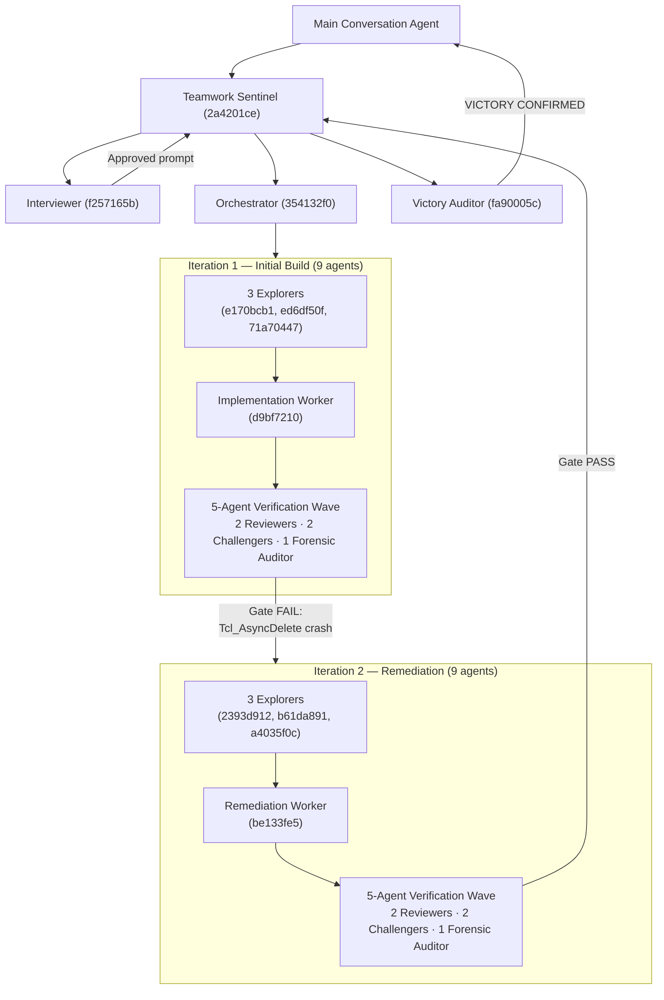

# Teamwork Multi-Agent Run Summary

This document summarizes how the `/teamwork` multi-agent run executed on **2026-11-24** (`19:45Z–20:33Z`) to update `pyproject.toml` packaging, add `python -m glcm3d` CLI support, and build the Tkinter single-file GUI (`src/glcm3d/gui.py`).

- **Total Teamwork Subagents Used:** **22** (23 including the main conversation agent)
- **Iterations:** **2** (Iteration 1 caught a Tkinter cross-thread GC crash; Iteration 2 fixed and re-verified it)
- **Final Verdict:** **VICTORY CONFIRMED** (`28/28` unit tests + multi-run `faulthandler` stress loops)

---

## 1. Architecture & Workflow

The Teamwork system separates **requirements gathering**, **coordination**, **exploration**, **implementation**, **adversarial verification**, and **final auditing** into distinct subagents so no single agent grades its own work.

---

## 2. How Each Agent Role Worked

### A. Coordination, Interview & Final Audit (4 agents)

| Agent | ID | Role & What It Did |
|---|---|---|
| **Teamwork Sentinel** | `2a4201ce` | Top-level lifecycle manager. Launched the interview, recorded the approved prompt (`ORIGINAL_REQUEST.md`), routed execution to the Orchestrator, ran periodic progress/liveness crons, invoked the independent Victory Auditor after the Orchestrator reported completion, and cleaned up all subagents/crons at the end. |
| **Interviewer** | `f257165b` | Clarified ambiguous requirements via a structured questionnaire (project name `glcm3D`, keeping `glcm3d` + adding `python -m glcm3d`, single-file Tkinter picker, progress bar/status text, GUI script entry point), then produced a formal task prompt draft with concrete Acceptance Criteria for user approval. |
| **Orchestrator** | `354132f0` | Managed the iterative engineering loop (`SCOPE.md`, `DISPATCH.md`, `BRIEFING.md`, `GATE_STATUS.md`, `progress.md`). Synthesized Explorer findings into scoped worker briefs, enforced the 5-agent verification gate, and triggered Iteration 2 when Iteration 1 failed the gate. |
| **Victory Auditor** | `fa90005c` | Independent final gatekeeper run after the Orchestrator finished. Verified file timestamps/provenance (Phase A), scanned for stubs/hardcoded results and ran behavioral probes across CLI, `pythonw.exe`, and default 46-TIFF GUI output (Phase B), and independently re-ran the full test suite and stress loops (Phase C). |

---

### B. Iteration 1 — Initial Implementation (9 agents)

**Goal:** Implement R1 (`pyproject.toml` naming + entry points), R2 (`python -m glcm3d`), R3 (`run_single_file`, `ProgressCallback`, and Tkinter `src/glcm3d/gui.py`), and automated tests.

| Agent | ID | Role | Outcome |
|---|---|---|---|
| **Explorer 1** | `e170bcb1` | Surveyed packaging (`pyproject.toml`, `uv.lock`) and CLI structure | Completed |
| **Explorer 2** | `ed6df50f` | Surveyed core pipeline (`core.py`, `chunked.py`, `pipeline.py`) for progress callback hooks | Completed |
| **Explorer 3** | `71a70447` | Surveyed existing tests (`tests/test_glcm3d.py`) and Tkinter environment | Completed |
| **Worker 1** | `d9bf7210` | Implemented `pyproject.toml`, `src/glcm3d/__main__.py`, `ProgressCallback`, `run_single_file`, `src/glcm3d/gui.py`, and `tests/test_cli_and_gui.py` (25 tests passing under `unittest discover`) | `DONE` |
| **Reviewer 1** | `159e1257` | Primary code review & full `unittest discover` run | `APPROVE` |
| **Reviewer 2** | `b6d5f719` | Secondary review running `tests/test_cli_and_gui.py` **standalone** | `REQUEST_CHANGES` |
| **Challenger 1** | `19df20f1` | Probed CLI, chunked edge cases, and single-file behavior | `APPROVE` |
| **Challenger 2** | `a70d3535` | Probed GUI behavior and Windows entry points | `APPROVE` |
| **Forensic Auditor 1** | `5828a4ed` | Independent integrity and standalone execution checks | `INTEGRITY VIOLATION` (Check 4) |

**Why Iteration 1 Failed the Gate:**
- Running `unittest discover` passed because running `tests/test_glcm3d.py` first shifted Python's garbage-collection threshold, masking a threading bug.
- Running `tests/test_cli_and_gui.py` **standalone** triggered a deterministic `Tcl_AsyncDelete: async handler deleted by the wrong thread` (`0x80000003`) crash during interpreter/GC teardown.
- Because the Forensic Auditor and Reviewer 2 both flagged this, the Orchestrator marked `GATE_STATUS.md` as **FAIL** and launched Iteration 2.

---

### C. Iteration 2 — Root-Cause Remediation & Re-Verification (9 agents)

**Goal:** Eliminate the cross-thread Tkinter/Tcl GC crash and add regression coverage.

| Agent | ID | Role | Outcome |
|---|---|---|---|
| **Explorer 1–3** | `2393d912`, `b61da891`, `a4035f0c` | Traced exact reference cycles causing the crash: `self._worker_target` / `inspect.signature` pinning `GLCMGuiApp`/`Tk` via `exc.__traceback__`, plus unremoved `Variable.trace_add` callbacks | Completed |
| **Worker 2** | `be133fe5` | Refactored `src/glcm3d/gui.py` to use a closure-free module-level `_run_worker(...)` (zero references to `self`, `root`, `frame`, or `tk.Variable`), added `compute_chunked` empty/non-3D `ValueError` validation, and added 6-cycle stressed-GC `weakref` tests (`tests/test_cli_and_gui.py` grew to 16 tests; 28 total) | `DONE` |
| **Reviewer 1** | `c1e1af04` | Verified `28/28` `unittest discover` + `5/5` `-X faulthandler` stress runs | `APPROVE` |
| **Reviewer 2** | `7af37bf7` | Verified `16/16` standalone `tests/test_cli_and_gui.py` + `10/10` `-X faulthandler` stress runs | `APPROVE` |
| **Challenger 1** | `abf30791` | Probed CLI, `compute_chunked` validation, and `run_single_file` edge cases | `APPROVE` |
| **Challenger 2** | `c0ae7087` | Probed GUI lifecycle and `pythonw.exe` null-stdio execution | `APPROVE` |
| **Forensic Auditor 2** | `e653a85c` | Re-ran Checks 1–4 + `5/5` `-X faulthandler` standalone stress runs | `CLEAN` |

**Iteration 2 Gate Result:** **PASS** (all 5 verification agents approved).

---

## 3. Final Victory Audit Highlights

The independent **Victory Auditor** (`fa90005c`) confirmed:
- **Phase A (Timeline & Provenance):** Monotonic file timestamps matching the two-iteration workflow; no stray `.agents` folder or workspace pollution.
- **Phase B (Integrity & Behavioral Probes):**
  - Zero `TODO`/`FIXME`/`NotImplementedError`/hardcoded shortcuts in `src/glcm3d/`.
  - `importlib.metadata.distribution("glcm3D")` confirmed `Name: glcm3D`, `Version: 0.1.0`, and both `glcm3d` and `glcm3d-gui` entry points.
  - Bit-for-bit identical `float32` TIFF outputs across `run_pipeline`, `run_single_file`, `python -m glcm3d`, and `glcm3d.exe`.
  - Clean `pythonw.exe` (null `stdout`/`stderr`) GUI execution and full default-config single-file run producing all 46 expected `float32` TIFFs (23 features × 2 radii).
- **Phase C (Independent Test Execution):**
  - `28/28` tests passing via `.\.venv\Scripts\python.exe -X faulthandler -m unittest discover -s tests -v` (`8.35s`).
  - `16/16` standalone GUI/CLI tests passing + `5/5` standalone and `3/3` discover `-X faulthandler` stress runs with zero crashes.

---

## 4. Model, Timing & Token Resource Breakdown

- **Model used:** All **22 Teamwork subagents** ran on **Gemini 4 Hydrogen (High)** (while the main conversation agent ran on **Gemini 4 Neon (Medium)**).
- **Total wall-clock time:** **47m 58s** (`2,878s`, `19:45:20Z` – `20:33:18Z`), including ~6m for the user interview/approval, ~36m 27s for the Orchestrator (Iterations 1 & 2), and ~3m 57s for the final Victory Audit.
- **Aggregate resources across all 22 Teamwork subagents:**
  - **LLM turns:** `438`
  - **Tool calls:** `893`
  - **Uncached input tokens:** `2,834,115` (~2.83M)
  - **Cached input tokens:** `29,048,731` (~29.05M — ~91% prompt cache hit rate)
  - **Output tokens:** `621,729` (~622K)

> *Note: Wall-clock durations for Sentinel (`2,878s`) and Orchestrator (`2,187s`) include idle time waiting on subagents and user interview responses; parallel Explorers and Verification agents overlapped in time.*

| Agent | ID | Model | Wall Time | Turns | Tool Calls | Uncached Input | Cache Read | Output Tokens |
|---|---|---|---:|---:|---:|---:|---:|---:|
| **Sentinel** | `2a4201ce` | Gemini 4 Hydrogen (High) | 47m 58s | 49 | 65 | 275,345 | 2,608,557 | 33,961 |
| **Interviewer** | `f257165b` | Gemini 4 Hydrogen (High) | 4m 21s | 8 | 8 | 36,996 | 124,219 | 16,700 |
| **Orchestrator** | `354132f0` | Gemini 4 Hydrogen (High) | 36m 27s | 78 | 155 | 550,036 | 9,937,714 | 92,070 |
| **Victory Auditor** | `fa90005c` | Gemini 4 Hydrogen (High) | 3m 57s | 15 | 53 | 113,086 | 981,574 | 16,709 |
| Iter 1 — Explorer 1 (Pkg/CLI) | `e170bcb1` | Gemini 4 Hydrogen (High) | 3m 14s | 18 | 36 | 73,932 | 479,968 | 20,310 |
| Iter 1 — Explorer 2 (Pipeline) | `ed6df50f` | Gemini 4 Hydrogen (High) | 2m 52s | 11 | 34 | 81,390 | 435,065 | 22,288 |
| Iter 1 — Explorer 3 (Tests/GUI) | `71a70447` | Gemini 4 Hydrogen (High) | 3m 14s | 11 | 38 | 84,995 | 474,598 | 21,314 |
| Iter 1 — Worker | `d9bf7210` | Gemini 4 Hydrogen (High) | 5m 36s | 20 | 60 | 217,618 | 1,454,619 | 41,378 |
| Iter 1 — Reviewer 1 | `159e1257` | Gemini 4 Hydrogen (High) | 2m 21s | 11 | 29 | 90,440 | 444,767 | 15,311 |
| Iter 1 — Reviewer 2 | `b6d5f719` | Gemini 4 Hydrogen (High) | 6m 43s | 26 | 42 | 137,881 | 1,775,235 | 35,379 |
| Iter 1 — Challenger 1 | `19df20f1` | Gemini 4 Hydrogen (High) | 2m 20s | 12 | 25 | 75,305 | 408,586 | 21,012 |
| Iter 1 — Challenger 2 | `a70d3535` | Gemini 4 Hydrogen (High) | 2m 30s | 11 | 21 | 61,060 | 360,155 | 22,078 |
| Iter 1 — Forensic Auditor | `5828a4ed` | Gemini 4 Hydrogen (High) | 3m 25s | 17 | 36 | 110,525 | 1,022,999 | 22,522 |
| Iter 2 — Explorer 1 | `2393d912` | Gemini 4 Hydrogen (High) | 5m 37s | 21 | 39 | 115,274 | 1,173,399 | 37,011 |
| Iter 2 — Explorer 2 | `b61da891` | Gemini 4 Hydrogen (High) | 5m 34s | 24 | 34 | 118,012 | 1,386,889 | 37,711 |
| Iter 2 — Explorer 3 | `a4035f0c` | Gemini 4 Hydrogen (High) | 3m 19s | 13 | 40 | 114,829 | 841,303 | 24,584 |
| Iter 2 — Worker | `be133fe5` | Gemini 4 Hydrogen (High) | 6m 39s | 23 | 41 | 131,345 | 1,744,792 | 29,551 |
| Iter 2 — Reviewer 1 | `c1e1af04` | Gemini 4 Hydrogen (High) | 2m 56s | 12 | 33 | 94,305 | 625,380 | 16,931 |
| Iter 2 — Reviewer 2 | `7af37bf7` | Gemini 4 Hydrogen (High) | 3m 23s | 16 | 25 | 83,487 | 646,091 | 16,828 |
| Iter 2 — Challenger 1 | `abf30791` | Gemini 4 Hydrogen (High) | 3m 47s | 13 | 26 | 86,238 | 623,822 | 34,283 |
| Iter 2 — Challenger 2 | `c0ae7087` | Gemini 4 Hydrogen (High) | 2m 36s | 11 | 20 | 68,439 | 391,286 | 26,530 |
| Iter 2 — Forensic Auditor | `e653a85c` | Gemini 4 Hydrogen (High) | 3m 13s | 18 | 33 | 113,577 | 1,107,713 | 17,268 |
| **Total (22 agents)** | — | — | **47m 58s** *(wall)* | **438** | **893** | **2,834,115** | **29,048,731** | **621,729** |

---

## 5. Files Created or Modified

- `pyproject.toml` & `uv.lock` — renamed package to `glcm3D`, retained `glcm3d` CLI script, added `glcm3d-gui` GUI script.
- `src/glcm3d/__main__.py` — enables `python -m glcm3d`.
- `src/glcm3d/gui.py` — Tkinter GUI (`GLCMGuiApp`, `create_app`, `main`, `python -m glcm3d.gui`).
- `src/glcm3d/pipeline.py`, `src/glcm3d/chunked.py`, `src/glcm3d/core.py`, `src/glcm3d/config.py`, `src/glcm3d/__init__.py` — added `ProgressCallback` plumbing, `run_single_file(...)`, and `compute_chunked` input validation.
- `tests/test_cli_and_gui.py` — 16 new automated tests covering packaging, CLI, `run_single_file`, Tkinter GUI workflow, and GC/threading safety.
